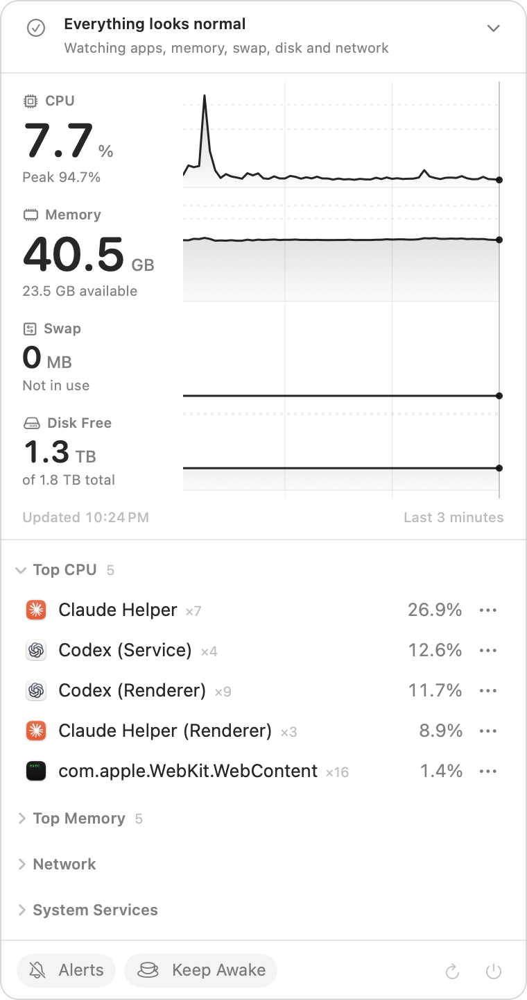

# SysBar

**A native macOS menu-bar monitor that tells you when something on your Mac needs attention, and why.**

[](https://github.com/SwifAI/sysbar/actions/workflows/ci.yml)


[](LICENSE)

<p align="center">
  <picture>
    <source media="(prefers-color-scheme: dark)" srcset="docs/images/popover-dark.png">
    
  </picture>
</p>

SysBar sits in your menu bar as a tiny CPU sparkline. Click it to see CPU, memory, swap and disk on one three-minute timeline, the processes behind them, and every port your Mac is listening on. When something goes wrong (an app stuck at full CPU, swap growing, disk filling, a new app accepting connections from your network), the status line says so and offers one or two buttons that fix it.

It is built only on Apple's frameworks. There are no third-party dependencies, no account and no analytics, and the menu-bar summary stays cheap while the popover is closed.

## Highlights

- **Seismograph overview.** CPU, memory, swap and disk are recorded as four live lanes on one shared three-minute time axis. Healthy lanes are monochrome; a lane turns orange or red, with a hatched band above its threshold, only when it crosses a warning or critical level. Threshold lines are always visible.
- **Attention watch.** Local rules notice what the graphs can't: one app holding more than a core for five minutes (twenty if it's the app you're using), CPU pinned, memory low, swap growing, disk filling fast, or a new non-Apple app accepting network connections. The status line says "Everything looks normal" or what needs attention, with SysBar's own measurement.
- **Buttons that fix it.** Each item ends in actions such as **Restart ChatGPT**, **Open Storage Settings** or **Allow node on 3000**. They come from a fixed list SysBar can perform itself. After a click, SysBar checks fresh samples and tells you whether it worked ("Done · Codex (Renderer) back to 3%"), or offers Force Quit if the app ignored the quit. The same buttons appear on the notification.
- **Optional AI briefs.** Turn on Claude or Codex and your own Claude Code or Codex CLI writes one line on why the item matters and picks which of the allowed buttons to show. The AI only chooses; SysBar writes every label and runs every action. With AI off, each item still gets SysBar's default buttons.
- **Living menu-bar glyph.** The status item draws a template sparkline of the last minute of CPU next to a fixed-width CPU and memory summary.
- **Top processes.** CPU and memory rankings grouped by executable path, so unrelated programs that share a filename stay separate, each with its app's icon.
- **Safe quit and force quit.** Process actions bind to PID, exact start time and executable path, then revalidate immediately before signaling, so a recycled PID is never signaled by mistake. Quitting several processes and every Force Quit ask first.
- **Listening ports.** TCP and UDP listeners with protocol, PID, port and bind address. LAN exposure is kept separate from loopback-only listeners. Verified macOS services (AirPlay Receiver, Continuity) are listed but never flagged. Search by process, PID, port, protocol or address, and filter All, LAN or Local.
- **Network context.** VPN state, primary address, DNS and transfer rates from native system APIs.
- **Opt-in alerts.** Notifications for new LAN-exposed listeners, VPN changes and critically low memory. SysBar asks for notification permission only when you turn alerts on.
- **Keep Awake.** An IOKit power assertion keeps the display awake until you turn it off or quit SysBar.
- **Accessible by default.** Dynamic Type, full keyboard control, VoiceOver (each lane is also an Audio Graph), Reduce Motion, Differentiate Without Color and semantic colors.

## Install

**Requirements:** macOS 13 Ventura or later on an Apple Silicon Mac.

### Download

1. Download the latest `SysBar-x.y.z.zip` from [Releases](https://github.com/SwifAI/sysbar/releases/latest), unzip it, and move **SysBar.app** to your Applications folder.
2. Release builds are ad-hoc signed, not notarized, so macOS blocks the first launch. Open **System Settings → Privacy & Security** and click **Open Anyway** next to SysBar. Alternatively, clear the quarantine flag in Terminal:

   ```bash
   xattr -dr com.apple.quarantine /Applications/SysBar.app
   ```

### Build from source

Building requires Swift 6.0+ and Xcode 16+.

```bash
git clone https://github.com/SwifAI/sysbar.git
cd sysbar
./build.sh
open build/SysBar.app
```

To install into `~/Applications` and launch the new build:

```bash
./build.sh --install
```

`build.sh` creates an arm64 release bundle with its localization resources and applies an ad-hoc signature (set `SYSBAR_SIGN_IDENTITY` to sign with a Developer ID instead). For a development-only bare executable, run `swift run -c release SysBar`. Notifications and Open at Login need the real app bundle, so they don't work in a bare-executable run.

## Using SysBar

- Click the menu-bar item to open or close SysBar. Opening SysBar again from Finder, Spotlight or Launchpad also opens it.
- Click the status line at the top to see what needs attention, its buttons, **Review now** and today's history. Restart, Quit and Open run on one click (the app's own save prompt still appears). **Details** shows the full explanation, **Remind me in 15 min** snoozes an item, **Dismiss** stops counting it, and **Mute today** ignores that app until midnight. **Allow** keeps SysBar quiet about a listener you started on purpose.
- Choose **AI briefs: Off · Claude · Codex** under System Services. SysBar detects both CLIs and uses Claude Opus at low effort, or Codex's default model at low reasoning. There is no model picker.
- Hover over the lanes, or focus a lane and press the Left and Right Arrow keys (with Shift for ten samples), to read any of the last three minutes.
- Click a warning or critical lane to unfold its explanation and safe actions.
- Use **Alerts** for notifications, **Keep Awake** for display sleep, and the **Startup** section for Open at Login.
- **Command-F** jumps to the listening-port search, **Command-R** refreshes, and **Command-Q** quits while the popover is active.
- Every process and port row has an accessible actions menu; right-click menus are an extra pointer shortcut.

## Privacy

- **Everything is measured on your Mac.** SysBar makes no network requests of its own and has no analytics or crash reporting.
- **AI briefs are off by default.** When you turn them on, SysBar runs your own Claude Code or Codex CLI on your existing subscription. It does so only when a rule trips (at most six times an hour) or when you press **Review now**, and it sends only the evidence for that item: the measurements and process or port details SysBar already shows you. Nothing is sent while everything looks normal.
- **The AI CLI is locked down.** Before every call, SysBar checks that the CLI is signed by its vendor's Developer ID. It then runs the CLI with no tools, MCP servers, settings or session history, a minimal environment without API keys, a private temporary folder, bounded input and output, and a 30-second timeout.

## Energy behavior

The menu-bar summary and popover details use separate publication models. Closing the popover stops process sampling, disk collection, and panel publications. Listening-port scans run every 15 seconds while open; when closed they run every 60 seconds only if notification delivery is active. Slow `lsof` work cannot block summary or process collection. While open, the panel publishes once per ~3-second tick (the summary waits for that tick's process sample), and only the telemetry sections re-render. While an AI provider is selected and the popover is closed, the attention watch takes one light process sample a minute, a ports scan a minute and a disk check every five minutes; with AI briefs Off, nothing extra runs while closed. An AI CLI runs only when a rule trips (at most six times an hour) or when you press Review now. Pressing an action button asks for a few extra samples to check its result (about a dozen over at most two minutes), popover open or closed. Trace animation is driven only by new samples (one short slide per ~3-second sample while open, run by Core Animation's render server rather than the app) or by the pointer; nothing animates while the popover is closed, and Reduce Motion removes the slide.

Each release's measured CPU and memory figures are in [CHANGELOG.md](CHANGELOG.md) and its release notes, against the targets in the [release checklist](#release-checklist). The project deliberately avoids embedding stale footprint claims in this README.

## How it works

SysBar is one `NSStatusItem` and one transient `NSPopover` hosting a SwiftUI view hierarchy. Data flows through one pipeline:

**Collect → Schedule → Coordinate → Model → Render**

1. **Collect:** actors sample CPU, processes and network through native APIs (table below).
2. **Schedule:** pure, heavily tested logic decides the adaptive cadence and coalesces overlapping requests.
3. **Coordinate:** a `@MainActor` monitor runs independent summary, process and slow pipelines, applies alert policy and holds the keep-awake assertion.
4. **Model:** every metric is `loading`, `available`, `stale` or `unavailable`, so the UI never shows a plausible-looking but wrong value.
5. **Render:** the popover and the menu-bar glyph. Trace ink is drawn by Core Animation shape layers, not SwiftUI animations.

| Area | Implementation |
|---|---|
| CPU | `host_statistics(HOST_CPU_LOAD_INFO)` delta ticks |
| Memory | `host_statistics64(HOST_VM_INFO64)` and `hw.memsize` |
| Swap | `sysctlbyname("vm.swapusage")` |
| Processes | `proc_listpids`, `PROC_PIDTASKALLINFO`, `proc_pidpath`, and exact identity revalidation |
| DNS | `SCDynamicStoreCopyValue` |
| VPN and interfaces | `getifaddrs()` |
| Listening ports | bounded `/usr/sbin/lsof` subprocess with structured field parsing |
| Disk | `FileManager.mountedVolumeURLs` resource values |
| Display wake | `IOPMAssertionCreateWithName` |

Only listener enumeration shells out; all other telemetry uses native Darwin, Mach, BSD, Foundation or IOKit APIs. Design decisions are recorded as ADRs in [`docs/adr/`](docs/adr/), and [`AGENTS.md`](AGENTS.md) maps every source file.

## Development

```bash
swift test                                                                   # full XCTest suite
swift build -Xswiftc -strict-concurrency=complete -Xswiftc -warnings-as-errors  # concurrency gate
./build.sh                                                                   # signed bundle + size budgets
```

GitHub Actions runs all three gates on macOS 15 and macOS 26, and a change is done only when all three pass. There is no linter or formatter; match the style of the surrounding code. Commits follow Conventional Commits (`fix:`, `feat:`, `docs:`, `perf:`, …). Any new user-facing string goes into both `Resources/Localizable.xcstrings` and the `en.lproj` runtime tables, or `LocalizationTests` fails.

Issues and pull requests are welcome. See [CONTRIBUTING.md](CONTRIBUTING.md), and for anything larger than a fix, please open an issue first so we can agree on the approach. Report security issues privately as described in [SECURITY.md](SECURITY.md).

## Release checklist

Before tagging a release:

1. Run the three required gates: `swift test`, `swift build -Xswiftc -strict-concurrency=complete -Xswiftc -warnings-as-errors`, and `./build.sh`. `./build.sh` exits with status 3 when the release executable or the signed app bundle exceeds its byte budget. The budgets are `EXECUTABLE_SIZE_BUDGET_BYTES` and `BUNDLE_SIZE_BUDGET_BYTES` at the top of `build.sh`, which also explains how to raise one deliberately.
2. Repeat the manual performance pass. CPU time and energy cannot be measured reliably on shared CI runners ([ADR-018](docs/adr/ADR-018-performance-regression-gate.md)), so this step stays manual. Measure an isolated, re-signed copy with its popover closed. Leave any installed SysBar running and untouched.

   ```bash
   tmp="$(mktemp -d)"
   cp -R build/SysBar.app "$tmp/"
   /usr/libexec/PlistBuddy -c "Set :CFBundleIdentifier io.github.swifai.sysbar.perfcheck" "$tmp/SysBar.app/Contents/Info.plist"
   codesign --force --sign - "$tmp/SysBar.app"
   "$tmp/SysBar.app/Contents/MacOS/SysBar" >/dev/null 2>&1 &
   pid=$!
   sleep 7                                        # warm up; keep the popover closed
   ps -o time= -p "$pid"; sleep 30; ps -o time= -p "$pid"
   sample "$pid" 5 -file "$tmp/sample.txt" >/dev/null
   grep "Physical footprint" "$tmp/sample.txt"
   grep -c "MenuContentView" "$tmp/sample.txt" || true    # expect 0 while closed
   ps -o rss= -p "$pid"
   kill "$pid"; rm -rf "${tmp:?}"
   ```

   Targets: at most 0.30 CPU-seconds between the two `ps -o time=` readings, and a physical footprint (including peak) under 45 MiB. RSS is recorded for context only.
3. Record the host, macOS version, toolchain, the two size lines printed by `./build.sh`, and each measurement against its target in the release's CHANGELOG entry and release notes. Keep measured numbers out of this README. A result over target blocks the release until it is fixed or explained there.

## License

SysBar is released under the [MIT License](LICENSE).
